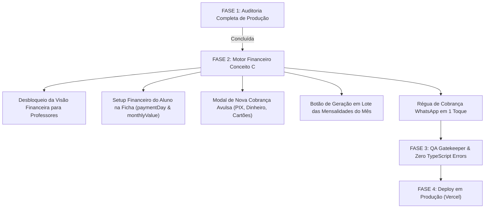

# 🏐 WILL TREINOS PRO — AUDITORIA COMPLETA DE PRODUÇÃO (MAPA DO APP V1)
**Data da Auditoria:** 21 de Outubro de 2026  
**Auditor Responsável:** Antigravity-Engine (Autonomous Engineering Co.)  
**Metodologia:** Governança `.agents/05-qa-gatekeeper.md` & `.agents/01-architect-modal-store.md`  
**Status do Compilador TypeScript:** ✅ 0 Erros (`pnpm exec tsc --noEmit` exit 0)

---

## 🧭 1. RESUMO EXECUTIVO DO SISTEMA EM PRODUÇÃO

O **Will Treinos PRO** é um ecossistema PWA esportivo de alto desempenho baseado em **Next.js 15 (App Router)**, **Supabase PostgreSQL com RLS blindada**, **Tailwind CSS** e **Framer Motion**.

Após as refatorações arquiteturais das Fases 1 a 5:
- O **WillCockpit.tsx** foi desmembrado de 3.687 para 3.326 linhas, com **33 modais isolados** no `CockpitModalHost.tsx`.
- O **StudentHome.tsx** foi otimizado de 1.842 para 1.654 linhas e teve seus `useState` reduzidos de 44 para apenas 9, com **36 modais sob demanda** no `StudentModalHost.tsx`.
- O **Modo Quadra** e o sistema de avaliação com **Swipe & Sliders táteis ($\ge 56\text{px}$)** e cache offline foram homologados com sucesso.

Apesar da excelente saúde estrutural do front-end, a auditoria de produção identificou **gargalos pontuais severos na camada financeira e de persistência de mensalidades**, que motivam a execução imediata do **Financeiro Conceito C**.

---

## 🗺️ 2. MAPA COMPLETO DE ROTAS E SEMAFORIZAÇÃO

### Legenda de Status:
- 🟢 **Operacional:** Lógica completa, integração ativa com Supabase, tratamento de erros e responsividade PWA.
- 🟡 **Parcial / Frágil:** Abre e funciona, mas depende de melhorias de UX, falta loading state dedicado, usa tipagem permissiva ou não sincroniza em tempo real.
- 🔴 **Faltando / Mockado:** Botões sem ação vinculada, cálculos mockados/hardcoded ou telas estáticas que não refletem dados reais do banco.

---

### 🌐 Camada Pública e Autenticação

| Rota / Tela | Papel | Descrição & Funcionalidades | Status | Observações Técnicas |
| :--- | :--- | :--- | :---: | :--- |
| `/` | Público | Landing Page oficial do Will Treinos PRO, apresentação de planos e CTAs. | 🟢 | Totalmente responsivo, Dark/Gold, SEO e PWA ready. |
| `/login` | Público | Autenticação via Supabase Auth (E-mail/Senha e OAuth Google). | 🟢 | Tradutor de erros pt-BR ativo (`authErrorTranslator.ts`). |
| `/signup` & `/cadastro` | Público | Tela de boas-vindas para convites exclusivos (*Invite-Only*). | 🟢 | Impede cadastro aberto indevido; direciona para WhatsApp. |
| `/esqueci-senha` | Público | Recuperação de senha por e-mail com Deep Link Supabase. | 🟢 | Integrado com feedback tátil e mensagens claras. |
| `/nova-senha` | Público | Redefinição de senha com validação de força. | 🟢 | Protegido por sessão de reset. |
| `/termos` | Público | Termos de uso da plataforma e LGPD esportiva. | 🟢 | Rota pública no `AuthWrapper.tsx` sem redirecionamento. |
| `/privacidade` | Público | Política de privacidade e proteção de dados dos atletas. | 🟢 | Rota pública no `AuthWrapper.tsx`. |
| `/aguardando` | Aluno | Sala de espera pós-cadastro até aprovação do coach. | 🟢 | Consulta em tempo real status de aprovação. |

---

### 📱 Camada do Atleta / Aluno (Mobile PWA)

| Rota / Tela | Papel | Descrição & Funcionalidades | Status | Observações Técnicas |
| :--- | :--- | :--- | :---: | :--- |
| `/dashboard` (`StudentHome`) | Aluno | Painel central: XP, próximo treino, missões e conquistas. | 🟢 | 9 useStates, orquestrado via `StudentModalHost`. |
| `/treinos` | Aluno | Lista de treinos, histórico de fundamentos e plano individual. | 🟢 | Sincronizado com `GamificationContext`. |
| `/agenda` | Aluno | Grade semanal de aulas, check-in e solicitação de reposição. | 🟢 | Abre `StudentLessonAgendaSheet` ao tocar em aulas. |
| `/ranking` | Aluno | Hall da Fama, ranking geral e ranking de turma com badges. | 🟢 | Fórmula de 1000 XP/nível alinhada. |
| `/feed` | Aluno | A Rede — Feed social com fotos, treinos e interações da quadra. | 🟢 | Suporte a upload com compressão e reações. |
| `/perfil` | Aluno | Dados pessoais, apelido, posição em quadra e progresso de nível. | 🟢 | Sincronizado com `AppConfigContext`. |
| `/atleta/[id]` | Compartilhado | Card público do atleta com radar de fundamentos e conquistas. | 🟢 | Rota dinâmica de alta performance. |
| `StudentPaymentSheet` | Aluno | Modal de pagamento de mensalidade com PIX copia-e-cola e envio de print. | 🟡 | Falta exibir múltiplos meios aceitos (Dinheiro/Cartão) e data de vencimento personalizada do professor. |

---

### 📋 Camada do Treinador / Professor (`coach`)

| Rota / Tela | Papel | Descrição & Funcionalidades | Status | Observações Técnicas |
| :--- | :--- | :--- | :---: | :--- |
| `/dashboard` (`CoachHome`) | Coach | Prancheta do dia: aulas de hoje, lista de presença rápida e feed. | 🟢 | Interface limpa com safe-area mobile. |
| `/agenda` | Coach | Criação e cancelamento de aulas, lista de alunos matriculados. | 🟢 | Abre `LessonDetailModal` e `QuickAttendancePanel`. |
| `/alunos` | Coach | Lista de alunos da academia com busca fuzzy (`fuse.js`). | 🟡 | Mostra plano e dia de vencimento, mas editar esses campos não gerava faturas pendentes. |
| `/will/court` | Coach | Modo Quadra: chamada rápida, QR Code e avaliação em tempo real. | 🟢 | PWA Offline-First com `BulkEvaluationModal`. |
| `/financeiro` (`CoachFinanceiro`) | Coach | **Visão de Cachê do Professor.** | 🔴 | **CRÍTICO:** Tela estática mockada com valor fixo `R$ 80/aula`. O professor **não tem acesso aos pagamentos reais dos alunos** nem pode lançar recebimentos! |

---

### 👑 Camada Administrativa / Dono (`admin` / Will)

| Rota / Tela | Papel | Descrição & Funcionalidades | Status | Observações Técnicas |
| :--- | :--- | :--- | :---: | :--- |
| `/will` (`WillCockpit`) | Admin | Centro de comando global: KPIs, turmas, alertas e ferramentas. | 🟢 | 33 modais no `CockpitModalHost`, performance estável. |
| `/financeiro` (`AdminFinanceiro`) | Admin | Extrato de pagamentos recebidos, pendentes e em atraso. | 🟡 | Visualiza comprovantes de PIX e dá baixa, mas **não possui botão para gerar mensalidades do mês** nem lançar cobranças avulsas manualmente. |
| `/configuracoes` | Admin | Chave PIX, nome do recebedor, geolocalização e horários. | 🟢 | Persistido no Supabase via `app_config`. |
| `StudentFinanceSheet` | Admin/Coach | Ficha financeira individual do aluno no Cockpit. | 🟡 | Mostra histórico de faturas e botão "Pago", mas **não permite ao treinador editar o Dia de Vencimento (`paymentDay`) e Valor da Mensalidade (`monthlyValue`)**. |

---

## 🔍 3. ANÁLISE DOS 33 MODAIS DO COCKPIT & 36 MODAIS DO ALUNO

### Modais do Cockpit (`CockpitModalHost.tsx`):
- **Gestão de Aula (7 modais):** `quickAttendance` 🟢, `qrCheckin` 🟢, `lessonRecap` 🟢, `bulkEvaluation` 🟢, `liveLessonCoach` 🟢, `createLesson` 🟢, `lessonDetail` 🟢.
- **Gestão de Alunos (10 modais):** `athleteTwin` 🟢, `evaluationHistory` 🟢, `studentFinance` 🟡, `temporalComparison` 🟢, `studentReport` 🟢, `scoutMode` 🟢, `importStudents` 🟢, `broadcastMessage` 🟢, `globalSearch` 🟢, `sessionExpired` 🟢.
- **Inteligência & Administração (16 modais):** `coachCopilot` 🟡 (heurístico se sem chave AI), `oracleInsights` 🟡, `turmaAnalytics` 🟢, `businessAnalytics` 🟢, `xpModeration` 🟢, `evaluationTemplates` 🟢, `appHealth` 🟢, `adminSettings` 🟢, `categoryManager` 🟢, `churnPrevention` 🟢, `attention` 🟢, `attendanceHeatmap` 🟢, `absenceTracker` 🟢, `onlineStudents` 🟢, `courtWeather` 🟢, `hallOfFame` 🟢.

### Modais do Aluno (`StudentModalHost.tsx`):
- **Todos os 36 modais operam via `next/dynamic`:** `payment` 🟡, `qrScanner` 🟢, `checkIn` 🟢, `reposition` 🟢, `freeTraining` 🟢, `attendanceCalendar` 🟢, `lessonHistory` 🟢, `studentAgenda` 🟢, `studentMessages` 🟢, `studentPillar` 🟢, `studentSchedule` 🟢, `studentGoals` 🟢, `welcome` 🟢, etc.

---

## 🚦 4. MATRIZ DE VULNERABILIDADES IDENTIFICADAS

1. **🔴 Falha 1 (Bloqueio do Treinador no Financeiro):**
   - Treinadores que atuam no dia a dia da quadra recebem mensalidades em dinheiro ou na maquininha, mas estavam trancados na tela de "Meu Cachê" mockada, sem poder gerenciar faturas dos alunos.
2. **🔴 Falha 2 (Inexistência de Geração Automática/Lote de Mensalidades):**
   - Se o mês virar (ex: início de Novembro), nenhuma mensalidade é gerada no banco de dados. A função `seedPendingTuitionForStudent` existe no código mas não possui disparador na UI.
3. **🟡 Falha 3 (Falta de Lançamento Avulso e Métodos Diversificados):**
   - Treinadores não conseguem lançar cobranças extras (ex: Matrícula R$ 100, Torneio R$ 60, Uniforme R$ 120), e só havia fluxo formal de PIX, sem seleção explícita de `Dinheiro`, `Cartão de Crédito` e `Cartão de Débito`.
4. **🟡 Falha 4 (Setup Financeiro Escondido do Aluno):**
   - Para ajustar o dia de vencimento de um aluno de 5 para 10, o treinador precisava ir na aba `/alunos`, abrir um drawer secundário e salvar. A `StudentFinanceSheet` não permitia alteração imediata.

---

## 🚀 5. ROADMAP DE IMPLEMENTAÇÃO E LANÇAMENTO

---

*Documento gerado e persistido no repositório em `docs/AUDITORIA_PRODUCAO_V1.md`.*
